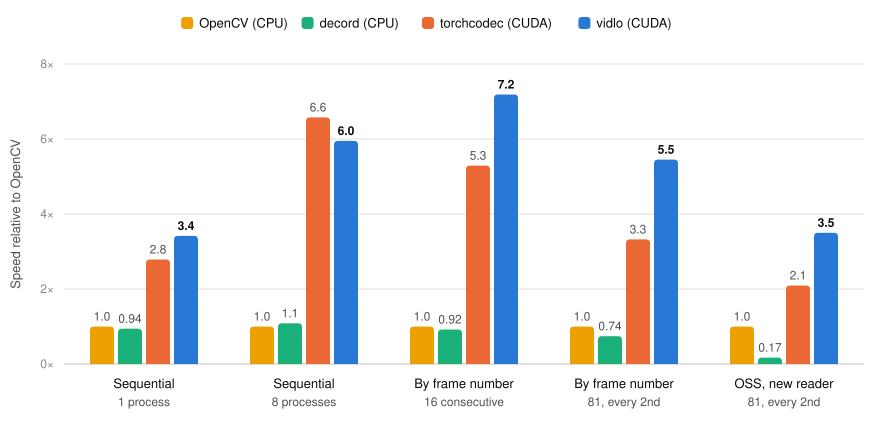

<p align="center">
  
</p>

<h1 align="center">vidlo</h1>

<p align="center">
  Read video frames on the GPU: decode with NVDEC, crop, convert and resize with CV-CUDA,<br>
  from local files, S3-compatible storage or Alibaba Cloud OSS.
</p>

<p align="center">
  
  
  
  
  
  
  
</p>

## Features

- **GPU end to end**: NVDEC decodes, CV-CUDA crops, converts YUV to RGB and resizes; only the final image is copied to CPU memory.
- **Checked decoding**: every frame's decode status is checked, frames are matched to their packets and timestamps, and colors follow the matrix tagged in the video. Output is tested frame by frame against FFmpeg.
- **Object storage**: S3-compatible storage (Cloudflare R2) and Alibaba Cloud OSS. Reading sequentially is one streaming request; reading by frame number is one byte-range request per call. Reads resume after network errors while making sure the object did not change.
- **Frame selection**: every k-th frame, or frame-rate conversion compatible with VPF's `EMDownSampler`; frames that are not kept are never converted or copied.
- **Index-ready**: each frame reports the byte range of its packet and where decoding must start, so a pipeline can write [video indexes](docs/index-format.md) in one pass.
- **Reading by frame number**: with a video index, one byte-range read per request, decoding starts at the right key frame and skips frames nothing refers to; hardware decoders are reused across requests and files.

## Comparison

All libraries read the same recording and return CPU `uint8` RGB at 832×480 after cropping 16 columns from each side.[^pixels] NVIDIA H200, 20 Intel Xeon CPU cores; HEVC Main, 1,280×720 at 60 fps.[^setup][^reproduce]

<p align="center">
  <picture>
    <source media="(prefers-color-scheme: dark)" srcset="docs/assets/compare-dark.svg">
    
  </picture>
</p>

Speed relative to OpenCV, higher is better: frames/s for sequential reading, otherwise the inverse of the median time per request (on OSS, per sample including opening the reader). torchcodec uses its faster call in each case (1 frame per call with 1 process, 64 frames per call with 8 processes). On OSS, torchcodec and OpenCV read ahead 1 MiB; HTTP requests and bytes are in the object storage table.

**Sequential reading** — aggregate frames/s, median of 3 trials; each process reads the whole recording after warm-up.[^sequential]

| Library / call | 1 process | 8 processes |
| --- | ---: | ---: |
| vidlo (CUDA) | 1,524 | 5,352 |
| torchcodec (CUDA), `get_frames_in_range`, 1 frame/call | 1,243 | 4,841 |
| torchcodec (CUDA), `get_frames_in_range`, 64 frames/call | 943 | 5,915 |
| OpenCV (CPU) | 446 | 899 |
| decord (CPU) | 420 | 977 |

vidlo is fastest with 1 process; torchcodec in batches of 64 is fastest at 8 processes (vidlo returns one frame at a time and has no batch call for sequential reading).

**Reading by frame number** — 1 process, p50 (p90) ms/request; the same 30 requests per shape for every library, using a warmed reader.[^metadata]

| Library | 16 consecutive frames | 81 frames, every 2nd |
| --- | ---: | ---: |
| vidlo | 27.9 (35.1) | 102.0 (123.8) |
| torchcodec | 37.9 (50.2) | 167.3 (191.7) |
| OpenCV | 200.5 (267.3) | 556.0 (684.6) |
| decord | 217.7 (267.2) | 751.1 (961.7) |

Every returned frame matched the same library's sequential read bit for bit; this does not imply identical pixels across libraries.[^pixels]

**Object storage** — Alibaba Cloud OSS, internal endpoint in the same region. Each sample opens a new reader and requests 81 frames, every 2nd. Counts and decimal MB are medians including opening; time is p50 (p90) ms for opening plus reading.[^oss]

| Library | Read-ahead | HTTP GETs (at open) | MB fetched (at open) | Time, ms |
| --- | ---: | ---: | ---: | ---: |
| vidlo | — | 1 (0) | 7.95 (0) | 152 (186) |
| torchcodec | 1 MiB | 10 (1) | 9.44 (1.05) | 254 (332) |
| torchcodec | 8 MiB | 3 (1) | 16.78 (8.39) | 255 (318) |
| OpenCV | 1 MiB | 11 (1) | 10.49 (1.05) | 532 (622) |
| OpenCV | 8 MiB | 4 (1) | 25.17 (8.39) | 622 (757) |
| decord | — | 1 (1) | 322.67 (322.67) | 3,116 (—) |

vidlo fetches nothing when opening, then exactly the bytes the requested frames need with one request. The other libraries read the container header when opening and then read through a file object, so their request count depends on the read-ahead: a larger block means fewer requests but more bytes, and it did not make a sample faster here. A reader kept open across samples of one video pays for opening once; per sample it then needs 9 (1 MiB) or 2 (8 MiB) requests with torchcodec and 10 or 3 with OpenCV. decord reads the whole 323 MB object into memory when it opens. OSS speed varies substantially over minutes: requests and bytes are the stable comparison. These are resource measurements, not monetary costs.

[^pixels]: Resize algorithms differ: vidlo uses CV-CUDA area; torchcodec uses torch `area` (adaptive average pooling); OpenCV/decord use `cv2.INTER_AREA`. OpenCV converts as BT.601 regardless of the recording's full-range BT.709 tags; the others use BT.709.

[^setup]: One recording only: `rgb-20261022-030320.mkv`, 7,706 frames, 322,673,914 bytes, closed GOPs of 60 frames with B-frames, MKV. Local file in page cache; GPU otherwise idle. NVIDIA H200, driver 570.133.20, CUDA 12.8, 20 visible Intel Xeon CPU cores, Python 3.12.13. Versions: vidlo 0.1 (development build) and torchcodec 0.17.0+cu126 with torch 2.14.1+cu126 both loaded FFmpeg 7.1.5; OpenCV 5.0.0 uses its bundled FFmpeg (libavcodec 62); decord 0.6.0 uses its bundled FFmpeg (libavcodec 58). decord is the PyPI CPU wheel; a GPU build requires compiling from source.

[^sequential]: OpenCV/decord use library-default CPU thread settings (`--threads 0`) with 1 process; at 8 processes, each has 2 decode threads and 2 cv2 threads. Total CPU cores used (CPU time / wall time) in the median-throughput trials at 8 processes: vidlo 7.59, torchcodec batches of 64 3.96, OpenCV 16.17, decord 18.11. torchcodec's `decoder[i]` per-frame call is much slower at 8 processes: 1,951 frames/s.

[^metadata]: vidlo receives a precomputed video index; torchcodec receives `custom_frame_mappings` from `ffprobe`; preparing and loading these are outside the timers. OpenCV/decord receive no precomputed per-video metadata. This also applies to OSS. Local requests follow a full sequential reference read and a warm-up request for each shape; CPU libraries use their default thread settings.

[^oss]: vidlo uses its own indexed storage reader: one Range GET covering the needed byte range. The other three use a file object adapter with a shared OSS client per process, no SDK retries, known object size (no HEAD), one Range GET per cache miss for at least the read-ahead size, and one cached block. The six rows alternated in 3 rounds in the same time window: vidlo and each torchcodec/OpenCV setting took 4 timed samples after 1 warm-up per round (12 total); decord took 1 per round without warm-up (3 total, so no p90 reported), from the same request list. All remote outputs matched the same library's local reads; no request was retried.

[^reproduce]: Run `python benchmarks/compare.py --help` ([script](benchmarks/compare.py)). Use a separate invocation per library, mode and configuration, each library in its own environment, with the recording, frame count, index/mappings and thread/sample settings above. Supply the OSS source, object size and storage options for remote runs.

## Install

Wheels for Python 3.11–3.14 (Linux x86-64, manylinux_2_28) are attached to the [releases](https://github.com/Lixsp11/vidlo/releases).

```bash
pip install vidlo-0.1-cp312-cp312-manylinux_2_28_x86_64.whl            # local files
pip install "vidlo-0.1-cp312-cp312-manylinux_2_28_x86_64.whl[s3,oss]"  # plus R2/S3 and OSS
```

Needs an NVIDIA GPU from Turing on (the bundled CV-CUDA is built for sm_75, 80, 86, 89, 90, 100 and 120) with driver 570 or newer. In containers, `NVIDIA_DRIVER_CAPABILITIES` must include `video`.

## Usage

```python
import vidlo

with vidlo.VideoReader("game.mkv", crop=(32, 0, 1248, 720), width=832, height=480) as reader:
    for frame in reader.frames(step=2):
        frame.image   # numpy uint8, (480, 832, 3), RGB
        frame.pts     # timestamp in units of reader.metadata.time_base

with vidlo.VideoReader("game.mkv", index="game.index.json", width=832, height=480) as reader:
    batch = reader.get_frames_at([3000, 3002, 3004])
    batch.images      # numpy uint8, (3, 480, 832, 3)
```

See [docs/api.md](docs/api.md) for every option and [docs/index-format.md](docs/index-format.md) for index files.

## Built with

| | |
| --- | --- |
| [NVIDIA Video Codec SDK 13.0](https://developer.nvidia.com/video-codec-sdk) (NVDEC) | hardware HEVC decoding |
| [CV-CUDA 0.19](https://github.com/CVCUDA/CV-CUDA) | crop, color conversion and resize on the GPU; built from source with only the operators vidlo uses |
| [FFmpeg 7.1](https://ffmpeg.org/) (libavformat, LGPL build) | demuxing |
| [pybind11](https://github.com/pybind/pybind11) · [scikit-build-core](https://github.com/scikit-build/scikit-build-core) | Python bindings and build |
| [boto3](https://github.com/boto/boto3) · [alibabacloud-oss-v2](https://github.com/aliyun/alibabacloud-oss-python-sdk-v2) | object storage |
| [cibuildwheel](https://github.com/pypa/cibuildwheel) · [auditwheel](https://github.com/pypa/auditwheel) | release wheels |
